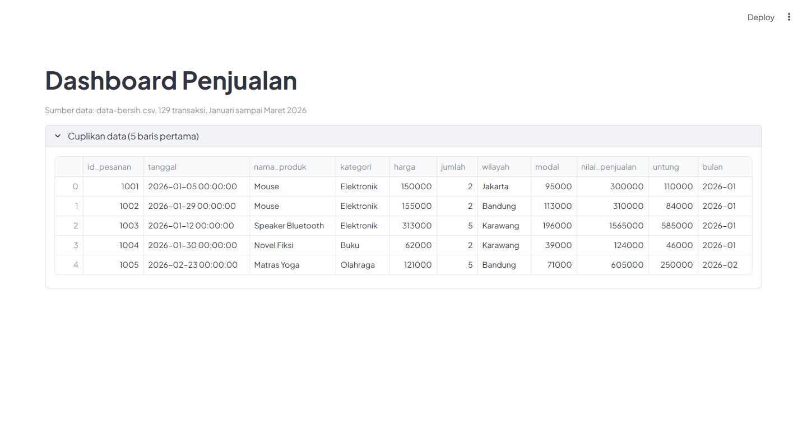
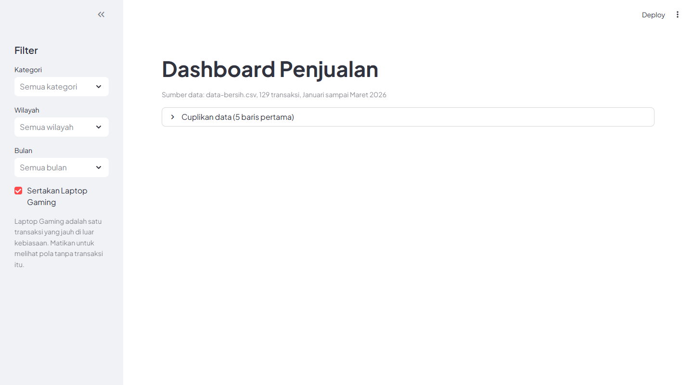
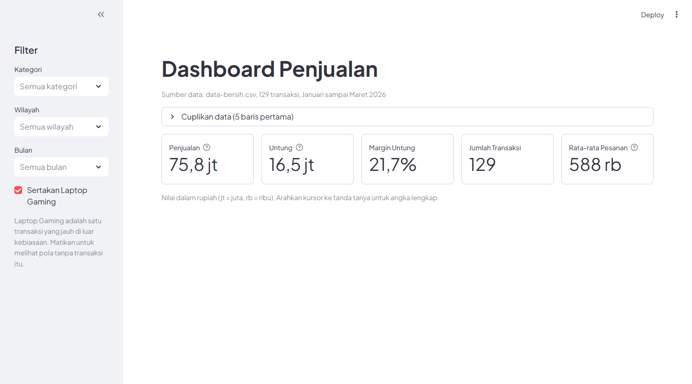
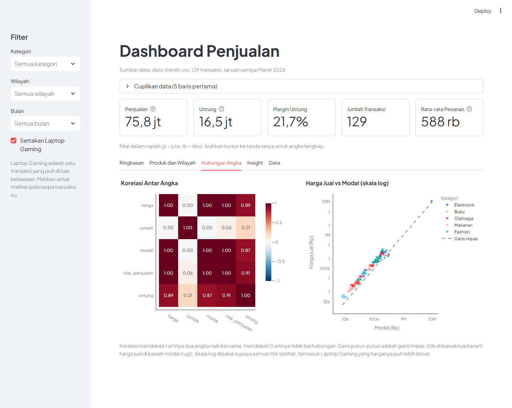
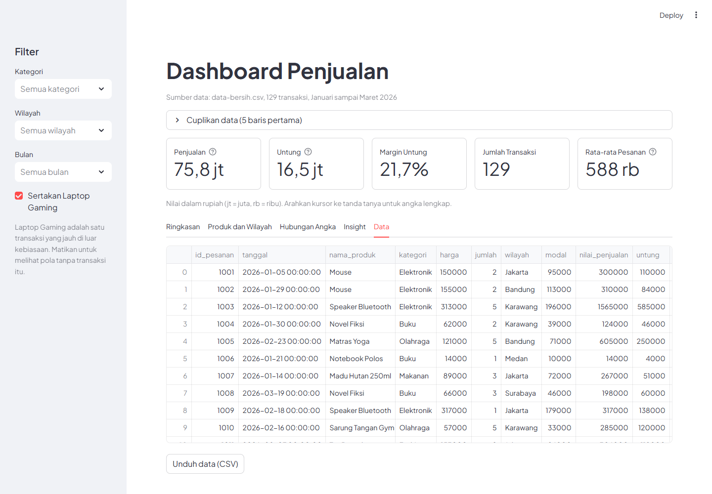
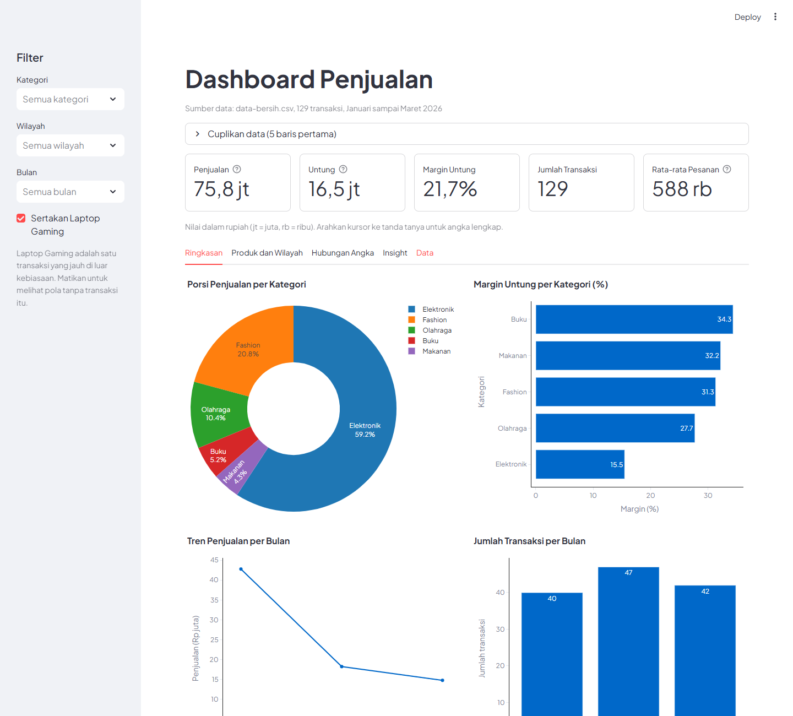
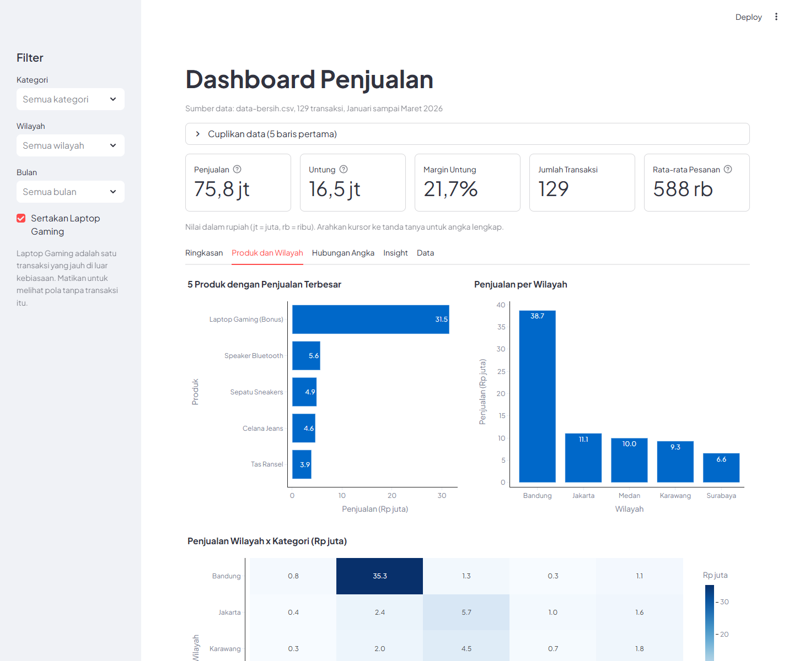
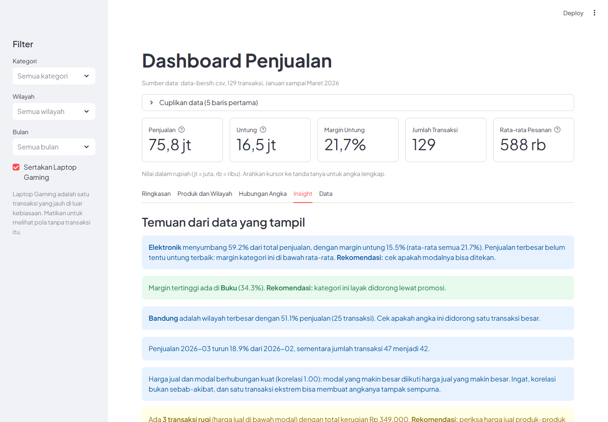
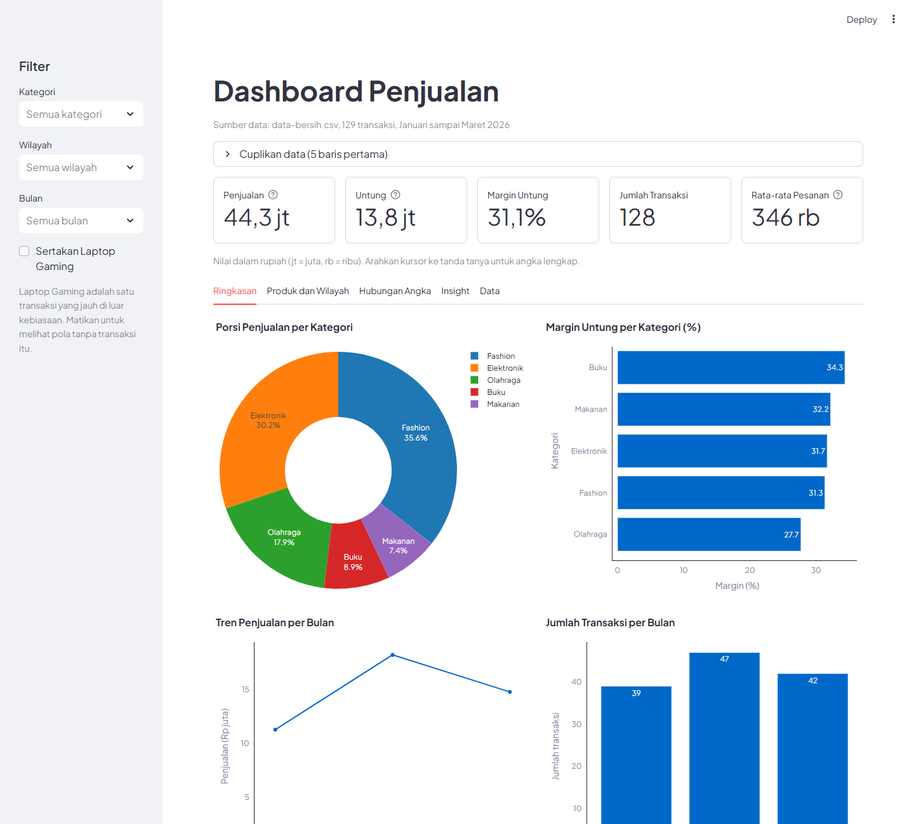
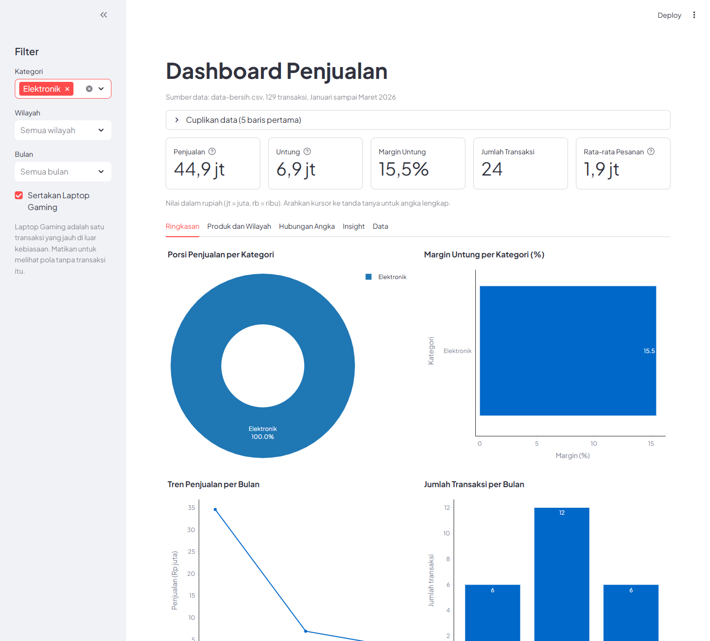

# Pertemuan 6 — Dashboard Streamlit, GitHub, dan Deploy Publik

**Durasi:** 19.30–21.00 WIB
**Tools:** VS Code, Python, Streamlit, Pandas, Plotly, Git, GitHub, Streamlit Community Cloud
**Output:** Peserta punya dashboard penjualan interaktif yang jalan di komputer sendiri, tersimpan di GitHub, dan bisa dibuka siapa saja lewat link publik.

## Cara Menggunakan Folder Ini

- **`dashboard-penjualan/`** — proyek dashboard yang sudah jadi. Folder inilah yang nanti diunggah ke GitHub dan di-deploy. Kalau ikut kelas dari awal, jangan salin dulu: bangun sendiri `app.py` lewat bagian Hands-on, lalu bandingkan dengan folder ini kalau tertinggal.

- **`pertemuan-6.ipynb`** — notebook Colab untuk menyiapkan **logika** dashboard (filter, KPI, grafik, insight) sebelum dipasang ke Streamlit. Buka lewat [colab.research.google.com](https://colab.research.google.com/) (`File > Upload notebook`), lalu upload juga `data-bersih.csv` lewat panel Files di sebelah kiri. Streamlit sendiri **tidak dijalankan di Colab**, tapi di VS Code.

- **`data-bersih.csv`** — dataset yang sama persis dengan pertemuan 4 dan 5 (129 transaksi, Januari sampai Maret 2026). Di dalam proyek, salinannya ada di `dashboard-penjualan/data/data.csv`.

- **`gambar/`** — screenshot dashboard di tiap tahap, sebagai pembanding hasil milikmu.

## Tujuan Belajar

- Menjelaskan apa itu dashboard dan apa fungsi Streamlit.

- Menyusun struktur folder proyek dashboard.

- Menampilkan data, metrik, filter, dan grafik interaktif dengan Streamlit.

- Menjalankan dashboard secara lokal dan membaca pesan error saat debugging.

- Mengunggah proyek ke GitHub (`init`, `add`, `commit`, `push`) tanpa membocorkan rahasia.

- Menulis `README.md` proyek yang informatif.

- Membuat dashboard bisa dibuka publik lewat Streamlit Community Cloud.

- Memahami ketentuan proyek akhir.

## Rundown

> Kalau waktu hands-on dashboard mepet, kerjakan sampai tab **Ringkasan** (Langkah 5) saja di kelas. Tab Produk, Hubungan Angka, Insight, dan Data (Langkah 6–9) bisa dilanjutkan di rumah. Folder `dashboard-penjualan/` sudah lengkap sebagai pembanding.

| Waktu | Aktivitas |
|---|---|
| 19.30–19.40 | Cek setup (Python, VS Code, akun GitHub) dan struktur folder proyek |
| 19.40–19.55 | Teori: dashboard, cara kerja Streamlit, widget, struktur proyek |
| 19.55–20.25 | Hands-on: membangun `app.py` tahap demi tahap (Langkah 1–9) |
| 20.25–20.33 | Debugging: membaca pesan error (Langkah 11). Font (Langkah 10) opsional |
| 20.33–20.50 | Hands-on: README proyek, Git, dan GitHub (Langkah 12–14) |
| 20.50–20.57 | Demo mentor: deploy ke Streamlit Community Cloud (Langkah 15–17) |
| 20.57–21.00 | Arahan proyek akhir dan penutup |

## Teori

### Dari Notebook ke Dashboard

Di pertemuan 1–5 kita bekerja di notebook: tulis kode, jalankan, lihat hasil. Notebook bagus untuk **menganalisis**. Tapi kalau hasilnya mau ditunjukkan ke atasan, dosen, atau klien, mereka tidak mau membuka kode.

**Dashboard** adalah halaman web yang menampilkan angka dan grafik penting dalam satu layar, dan biasanya bisa **difilter** oleh pembacanya.

| | Notebook | Dashboard |
|---|---|---|
| Untuk siapa | Analis (yang menulis kode) | Pembaca (yang butuh jawaban) |
| Isinya | Kode, hasil, dan catatan | Angka, grafik, dan filter |
| Cara pakai | Jalankan sel satu per satu | Buka link, pilih filter |
| Berubah kalau | Kode diedit | Pembaca mengubah pilihan |

### Apa Itu Streamlit

**Streamlit** adalah library Python untuk membuat dashboard **hanya dengan Python**, tanpa HTML, CSS, atau JavaScript. Kita menulis file `app.py` biasa, lalu Streamlit mengubahnya jadi halaman web.

```python
import streamlit as st

st.title("Halo")
st.write("Ini dashboard pertamaku")
```

Dijalankan dengan perintah ini di terminal:

```bash
streamlit run app.py
```

Browser terbuka otomatis di alamat seperti `http://localhost:8501`.

### Cara Kerja Streamlit: Skrip Dijalankan Ulang

Ini satu-satunya konsep yang benar-benar baru, dan penting dipahami:

- Streamlit menjalankan `app.py` **dari atas sampai bawah**.

- Setiap kali pengguna mengubah sesuatu (memilih filter, mencentang kotak), Streamlit menjalankan **seluruh skrip dari atas lagi**.

- Widget (seperti `multiselect`) mengembalikan **nilai pilihan pengguna**. Nilai itu dipakai untuk menyaring data, lalu angka dan grafik di bawahnya dihitung ulang.

```text
Pengguna memilih filter
        ↓
Streamlit menjalankan ulang app.py dari atas
        ↓
Widget mengembalikan pilihan terbaru
        ↓
Data disaring → angka dan grafik dihitung ulang → halaman diperbarui
```

Karena itu urutan kode penting: **widget filter harus ditulis sebelum kode yang memakai hasilnya**.

### Struktur Proyek Dashboard

```text
dashboard-penjualan/
├── app.py                 kode dashboard
├── data/
│   └── data.csv           dataset
├── requirements.txt       daftar library yang dibutuhkan
├── .gitignore             daftar file yang tidak ikut diunggah ke GitHub
├── .streamlit/
│   └── config.toml        pengaturan tampilan (misalnya font)
└── README.md              penjelasan proyek
```

| File | Fungsinya |
|---|---|
| `app.py` | Kode dashboard. Nama ini yang kita jalankan dengan `streamlit run` |
| `data/data.csv` | Data disimpan di folder terpisah supaya rapi. Dibaca dengan `pd.read_csv("data/data.csv")` |
| `requirements.txt` | Daftar library. Dipakai orang lain (dan server Streamlit) untuk menginstal library yang sama |
| `.gitignore` | Daftar file yang **tidak boleh** ikut ke GitHub |
| `README.md` | Halaman depan proyek di GitHub: tujuan, sumber data, cara menjalankan, insight |

### Elemen Streamlit yang Dipakai

Semua perintah Streamlit diawali `st.`. Ini yang kita pakai hari ini:

| Perintah | Fungsinya |
|---|---|
| `st.set_page_config(...)` | Mengatur judul tab browser dan lebar halaman. Harus perintah Streamlit pertama |
| `st.title(...)` | Judul besar halaman |
| `st.caption(...)` | Teks kecil berwarna abu-abu, cocok untuk sumber data |
| `st.dataframe(df)` | Menampilkan tabel yang bisa di-scroll dan diurutkan |
| `st.metric(label, nilai)` | Satu angka ringkasan dengan label (misalnya total penjualan) |
| `st.columns(n)` | Membagi halaman jadi `n` kolom berdampingan |
| `st.sidebar` | Panel samping, tempat filter |
| `st.multiselect(...)` | Filter: pengguna memilih **beberapa** opsi sekaligus |
| `st.checkbox(...)` | Kotak centang: nilai `True` atau `False` |
| `st.plotly_chart(fig)` | Menampilkan grafik Plotly (interaktif) |
| `st.expander(...)` | Bagian yang bisa dibuka dan ditutup |
| `st.info(...)`, `st.warning(...)` | Kotak pesan berwarna |
| `st.stop()` | Menghentikan skrip di titik itu |
| `st.tabs([...])` | Membagi halaman jadi beberapa tab. Isinya ditulis di `with tab:` |
| `st.subheader(...)` | Judul bagian yang lebih kecil dari `st.title` |
| `st.success(...)` | Kotak pesan hijau (untuk kabar baik) |
| `st.download_button(...)` | Tombol untuk mengunduh data |
| `border=True`, `help=...` (pada `st.metric`) | Garis kotak di sekeliling kartu, dan tooltip berisi keterangan tambahan |

### Tab: Satu Halaman, Beberapa Pesan

Dashboard yang terlalu penuh membuat pembaca bingung harus melihat ke mana. Solusinya `st.tabs`: halaman dibagi jadi beberapa tab, dan **tiap tab membawa satu pesan**.

| Tab | Pesan yang disampaikan |
|---|---|
| **Ringkasan** | Gambaran besar: porsi penjualan, margin, tren, dan jumlah transaksi |
| **Produk dan Wilayah** | Siapa dan di mana: produk terlaris, wilayah terbesar, dan pola wilayah × kategori |
| **Hubungan Angka** | Apakah angka-angka saling berhubungan: korelasi dan scatter plot |
| **Insight** | Apa artinya: temuan dan rekomendasi dalam kalimat |
| **Data** | Bukti: tabel lengkap, bisa diunduh |

Lima kartu angka di atas tab selalu terlihat, karena itu angka yang paling sering ditanyakan. Cara ini juga cocok untuk presentasi: tinggal pindah tab sesuai alur cerita.

### Memilih Grafik untuk Dashboard

Pilihan grafik di dashboard mengikuti prinsip pertemuan 5: **mulai dari pertanyaannya**.

| Pertanyaan | Grafik di dashboard |
|---|---|
| Kategori mana yang porsinya paling besar? | Pie atau donut chart |
| Kategori mana yang paling menguntungkan? | Bar chart margin |
| Penjualan naik atau turun dari bulan ke bulan? | Line chart |
| Produk dan wilayah mana yang terbesar? | Bar chart (diurutkan) |
| Pola wilayah dan kategori sekaligus? | Heatmap |
| Angka mana yang saling berhubungan? | Heatmap korelasi |
| Apakah harga jual yang tinggi selalu diikuti modal yang tinggi? | Scatter plot |

Soal pie chart: pie bagus untuk melihat **porsi satu keseluruhan**, dan paling terbaca kalau ada satu bagian yang dominan seperti Elektronik di data kita. Tapi untuk **membandingkan** irisan yang kecil (Buku 5,2% dan Makanan 4,3%), mata kita sulit membedakan. Karena itu pie chart dipasangkan dengan bar chart, dan jangan dipakai kalau bagiannya banyak.

### Korelasi dan Skala Log

**Korelasi** mengukur seberapa kompak dua angka bergerak bersama. Nilainya antara -1 dan 1:

| Nilai | Artinya |
|---|---|
| Dekat 1 | Naik bersama (merah pekat di heatmap kita) |
| Dekat 0 | Tidak ada hubungan yang jelas (putih) |
| Dekat -1 | Berlawanan: yang satu naik, yang lain turun (biru pekat) |

Tiga hal yang wajib diingat (sama seperti pertemuan 5):

- **Korelasi bukan sebab-akibat.** Dua angka bergerak bareng belum tentu yang satu menyebabkan yang lain.

- **Hati-hati dengan kolom yang dihitung dari kolom lain.** `nilai_penjualan` itu `harga × jumlah`, jadi korelasinya tinggi karena rumus, bukan karena temuan.

- **Satu data ekstrem bisa menipu korelasi.** Di data kita, Laptop Gaming membuat korelasi harga-modal tampak 1,00. Tanpa transaksi itu, 0,95.

**Skala log** dipakai saat angkanya sangat timpang: ada yang puluhan ribu dan ada yang jutaan. Di skala biasa, angka besar menarik sumbu begitu jauh sampai yang kecil menumpuk jadi satu gumpalan. Di skala log, tiap kotak sumbu berarti "10 kali lebih besar", jadi semuanya terbaca. Kekurangannya: jaraknya tidak lagi proporsional, jadi skala log hanya dipakai kalau memang perlu, dan sebaiknya selalu diberi tahu di judul grafik.

### Penjualan Terbesar Belum Tentu Untung Terbaik

Ini temuan yang paling sering diabaikan pemula, dan sangat bagus untuk presentasi.

- **Penjualan** = harga jual × jumlah. Besar kalau barangnya mahal atau laris.

- **Untung** = penjualan dikurangi modal.

- **Margin untung** = untung dibagi penjualan, dalam persen. Ini ukuran seberapa efisien sebuah kategori mengubah penjualan jadi untung.

Di data kita, Elektronik punya penjualan terbesar (59,2%) tapi margin terendah (15,5%), sedangkan Buku hanya 5,2% dari penjualan tapi margin tertinggi (34,3%). Kalau kita hanya melihat penjualan, kita akan salah menyimpulkan bahwa Elektronik "paling bagus". Karena itu dashboard menampilkan **dua ukuran sekaligus**.

### Cara Kerja Filter

Filter punya tiga bagian: **widget**, **fungsi saring**, dan **tampilan**.

```python
pilihan = st.sidebar.multiselect("Kategori", ["Buku", "Fashion"])   # 1. widget: dapat pilihan pengguna
data_tampil = saring_data(df, pilihan)                              # 2. saring data
st.metric("Total", data_tampil["nilai_penjualan"].sum())            # 3. tampilkan dari data yang sudah disaring
```

- Semua angka dan grafik **harus dihitung dari `data_tampil`**, bukan dari `df` asli. Kalau salah satu masih memakai `df`, angka itu tidak berubah saat filter diubah.

- Filter yang dibiarkan kosong kita artikan sebagai **"tampilkan semua"**. Itu lebih nyaman daripada dashboard yang kosong saat belum ada pilihan.

- Kombinasi filter bisa menghasilkan **data kosong**. Dashboard yang baik tidak error, tapi menampilkan pesan ramah.

### `st.cache_data`: Jangan Baca File Berulang

Karena skrip dijalankan ulang tiap interaksi, `pd.read_csv(...)` ikut dibaca ulang terus. Untuk 129 baris tidak terasa, tapi untuk data besar sangat lambat.

```python
@st.cache_data
def baca_data():
    return pd.read_csv("data/data.csv")
```

`@st.cache_data` menyimpan hasil fungsi, jadi file hanya dibaca **sekali**. Hati-hati: kalau kamu mengganti isi CSV saat dashboard berjalan, hasil lama masih tersimpan. Tekan `C` di browser dan pilih **Clear cache**, atau hentikan dan jalankan ulang Streamlit.

### Membaca Pesan Error

Saat kode salah, Streamlit menampilkan kotak merah berisi **traceback**. Cara membacanya:

1. Lihat **baris paling bawah**: itu jenis dan penjelasan error.

2. Cari nama file dan nomor baris milikmu (`app.py:16`). Baris di file library (seperti `pandas`) bukan tempat salahnya.

| Error | Biasanya artinya |
|---|---|
| `FileNotFoundError` | Nama atau lokasi file salah. Cek `"data/data.csv"` dan folder tempat kamu menjalankan `streamlit run` |
| `KeyError: 'nama_kolom'` | Nama kolom salah ketik, atau kolomnya tidak ada |
| `ModuleNotFoundError` | Library belum terinstal, atau virtual environment belum aktif |
| `NameError` | Variabel dipakai sebelum dibuat (urutan kode salah) |

### Git dan GitHub

| | Git | GitHub |
|---|---|---|
| Apa | Program di komputermu yang mencatat riwayat perubahan kode | Situs yang menyimpan repository Git di internet |
| Analogi | Buku catatan versi | Lemari penyimpanan online |
| Dipakai untuk | `commit`: menyimpan "foto" kondisi kode | `push`: mengirim hasil commit ke internet, untuk dibagikan dan dikerjakan bersama |

Urutan perintah untuk pertama kali mengunggah proyek:

```bash
git init
git add .
git commit -m "Buat dashboard penjualan awal"
git branch -M main
git remote add origin URL_REPOSITORY_KAMU
git push -u origin main
```

- `git init` — mengubah folder jadi repository Git.

- `git add .` — menandai semua perubahan untuk disimpan.

- `git commit -m "..."` — menyimpan, lengkap dengan catatan singkat apa yang berubah.

- `git remote add origin ...` — memberi tahu Git alamat repository di GitHub.

- `git push` — mengirim commit ke GitHub.

### Kenapa Rahasia Tidak Boleh Diunggah

Repository GitHub yang **publik** bisa dibaca siapa saja di dunia, dan riwayatnya tersimpan. Karena itu jangan pernah mengunggah:

- **Password dan API key.** Orang lain bisa memakainya atas namamu, bahkan menghabiskan kuota atau tagihanmu. Bot memang memindai GitHub terus-menerus untuk mencari key yang bocor.

- **Data pribadi** (nama lengkap, nomor HP, email pelanggan). Itu soal privasi, dan sering melanggar aturan.

Cara menjaganya:

- Tulis nama file rahasia di **`.gitignore`**. Git akan mengabaikannya, jadi tidak ikut `git add .`.

- Cek `git status` sebelum `commit`, dan pastikan tidak ada file yang tidak kamu kenal.

- Kalau terlanjur terunggah, **hapus dari file tidak cukup**: buat key baru di penyedia layanannya dan matikan key yang lama.

Dataset kita (`data-bersih.csv`) hanya berisi data penjualan, tanpa nama pelanggan, jadi aman diunggah.

### README Proyek

`README.md` adalah halaman pertama yang dilihat orang saat membuka repository-mu. README yang baik menjawab: **apa ini, datanya dari mana, dan bagaimana menjalankannya**.

Tiga isi minimum:

1. **Tujuan proyek** — pertanyaan apa yang dijawab dashboard ini.

2. **Sumber data** — dari mana datanya, periodenya, dan satuannya.

3. **Cara menjalankan** — langkah instalasi dan perintah `streamlit run app.py`.

Tambahan yang sangat dianjurkan: **insight** yang ditemukan, screenshot, link demo, dan anggota kelompok. Contoh lengkapnya ada di `dashboard-penjualan/README.md`.

### Deploy ke Streamlit Community Cloud

Sampai sekarang dashboard hanya bisa dibuka di komputermu (`localhost`). **Deploy** artinya menaruhnya di komputer milik penyedia layanan yang menyala terus, lalu diberi alamat publik.

**Streamlit Community Cloud** adalah layanan gratis dari Streamlit untuk itu. Alurnya:

```text
1. Kode dashboard ada di repository GitHub
2. Streamlit Community Cloud membaca repository itu
3. Streamlit menginstal library dari requirements.txt dan menjalankan app.py
4. Dashboard bisa dibuka lewat alamat publik, misalnya nama-kamu.streamlit.app
```

Hal yang perlu diperhatikan:

- Yang dibaca Streamlit adalah **repository GitHub**, bukan folder di laptopmu. Apa yang belum di-push tidak akan muncul di sana.

- File `requirements.txt` wajib ada di akar repository (atau satu folder dengan `app.py`). Isinya menentukan library apa yang diinstal. Tanpa itu, dashboard error karena library tidak ditemukan.

- Repository **publik** cukup dengan izin GitHub bawaan. Repository privat butuh izin tambahan.

- Kamu perlu hak admin di repository yang mau di-deploy (repository milikmu sendiri otomatis memenuhi).

- Setelah dashboard berjalan, perubahan kode yang di-push ke GitHub akan tercermin di aplikasi. Perubahan library di `requirements.txt` perlu beberapa menit untuk terpasang.

- Aplikasi di layanan gratis bisa masuk mode tidur kalau lama tidak dibuka, dan perlu dibangunkan dulu saat dibuka kembali. Aturan detailnya bisa berubah, jadi cek dokumentasi Streamlit kalau perlu.

- Dashboard yang publik bisa dibuka siapa pun yang punya link. Jangan tampilkan data pribadi.

## Hands-on: Langkah demi Langkah

### Langkah 1 — Siapkan Folder dan Virtual Environment

1. Buat folder baru bernama `dashboard-penjualan`, lalu buka di VS Code (`File > Open Folder`).

2. Di dalamnya buat folder `data`, lalu salin `data-bersih.csv` ke situ dan ganti namanya jadi **`data.csv`**.

3. Buat file `requirements.txt` dengan isi:

```text
streamlit==1.50.0
pandas==2.3.3
plotly==6.5.2
```

4. Buka terminal VS Code (`Terminal > New Terminal`), lalu buat dan aktifkan virtual environment:

```bash
python -m venv .venv
.venv\Scripts\activate
pip install -r requirements.txt
```

Di Mac atau Linux, perintah aktifkannya `source .venv/bin/activate`.

- `python -m venv .venv` — membuat lingkungan Python khusus proyek ini, supaya library tidak bercampur dengan proyek lain.

- `pip install -r requirements.txt` — menginstal semua library di daftar.

**Cek hasil:** di awal baris terminal muncul `(.venv)`, dan perintah `streamlit --version` menampilkan nomor versi.

**Kalau error:**

- `python is not recognized` → tutup lalu buka ulang VS Code. Di Windows coba `py -m venv .venv`.

- `running scripts is disabled on this system` (PowerShell) → jalankan `Set-ExecutionPolicy -Scope CurrentUser RemoteSigned`, atau pakai terminal Command Prompt.

### Langkah 2 — Judul dan Tampilkan Data

Buat file `app.py`, lalu tulis kode ini:

```python
import pandas as pd
import plotly.express as px
import streamlit as st

st.set_page_config(page_title="Dashboard Penjualan", layout="wide")


@st.cache_data
def baca_data():
    df = pd.read_csv("data/data.csv")
    df["tanggal"] = pd.to_datetime(df["tanggal"])
    df["bulan"] = df["tanggal"].dt.to_period("M").astype(str)
    return df


df = baca_data()

st.title("Dashboard Penjualan")
st.caption("Sumber data: data-bersih.csv, 129 transaksi, Januari sampai Maret 2026")

with st.expander("Cuplikan data (5 baris pertama)"):
    st.dataframe(df.head())
```

Penjelasan singkat:

- `@st.cache_data` — hasil `baca_data()` disimpan, jadi file CSV hanya dibaca sekali.

- Kolom `tanggal` dari CSV berupa teks, jadi diubah ke tipe tanggal, lalu dibuat kolom `bulan` (misalnya `2026-01`). Sama seperti pertemuan 5.

- `st.expander(...)` — tabel disembunyikan dulu supaya halaman rapi. Klik untuk membukanya.

- `df.head()` — 5 baris pertama.

Jalankan di terminal:

```bash
streamlit run app.py
```

**Cek hasil:** browser terbuka dengan judul **Dashboard Penjualan**. Klik **Cuplikan data** dan tabel 5 baris muncul.



**Kalau error:**

- `FileNotFoundError: ... 'data/data.csv'` → pastikan terminal berada di folder `dashboard-penjualan` (bukan folder di atasnya) dan file bernama `data.csv` di dalam folder `data`.

- Browser tidak terbuka → buka sendiri alamat yang tertulis di terminal (`Local URL`).

Setelah ini, **biarkan Streamlit tetap berjalan**. Setiap kali kamu menyimpan `app.py`, pojok kanan atas halaman menampilkan tombol **Rerun**. Klik, atau pilih **Always rerun**, supaya halaman ikut berubah otomatis.

### Langkah 3 — Filter di Panel Samping

Tambahkan kode ini **di bawah** kode sebelumnya (beri dua baris kosong sebagai pemisah):

```python
# ---------- Filter ----------
# Pilihan dibiarkan kosong = tampilkan semua.
def saring_data(data, kategori, wilayah, bulan, sertakan_laptop):
    hasil = data
    if kategori:
        hasil = hasil[hasil["kategori"].isin(kategori)]
    if wilayah:
        hasil = hasil[hasil["wilayah"].isin(wilayah)]
    if bulan:
        hasil = hasil[hasil["bulan"].isin(bulan)]
    if not sertakan_laptop:
        hasil = hasil[hasil["nama_produk"] != "Laptop Gaming (Bonus)"]
    return hasil


st.sidebar.header("Filter")
pilih_kategori = st.sidebar.multiselect(
    "Kategori", sorted(df["kategori"].unique()), placeholder="Semua kategori"
)
pilih_wilayah = st.sidebar.multiselect(
    "Wilayah", sorted(df["wilayah"].unique()), placeholder="Semua wilayah"
)
pilih_bulan = st.sidebar.multiselect(
    "Bulan", sorted(df["bulan"].unique()), placeholder="Semua bulan"
)
sertakan_laptop = st.sidebar.checkbox("Sertakan Laptop Gaming", value=True)
st.sidebar.caption(
    "Laptop Gaming adalah satu transaksi yang jauh di luar kebiasaan. "
    "Matikan untuk melihat pola tanpa transaksi itu."
)

data_tampil = saring_data(df, pilih_kategori, pilih_wilayah, pilih_bulan, sertakan_laptop)

if data_tampil.empty:
    st.warning("Tidak ada data untuk kombinasi filter ini. Coba ubah pilihanmu.")
    st.stop()
```

Penjelasan singkat:

- `saring_data(...)` — fungsi yang menyaring data. Isinya sama dengan yang sudah kita coba di notebook. Pilihan kosong artinya filter itu tidak dipakai, jadi semua data tetap tampil.

- `st.sidebar.multiselect(...)` — filter di panel samping. Hasilnya berupa **daftar** pilihan pengguna. `placeholder` adalah tulisan abu-abu saat belum ada pilihan.

- Saklar **Laptop Gaming**: satu transaksi di data kita jauh di luar kebiasaan (ingat pertemuan 4 dan 5), jadi pengguna diberi pilihan untuk menyertakan atau tidak.

- `data_tampil` — data yang sudah disaring. Mulai sekarang, **semua angka dan grafik dihitung dari `data_tampil`**.

- `st.warning(...)` dan `st.stop()` — kalau kombinasi filter tidak punya data, tampilkan pesan lalu hentikan skrip, supaya kode di bawahnya tidak error.

**Cek hasil:** panel samping muncul dengan filter **Kategori**, **Wilayah**, **Bulan**, dan kotak **Sertakan Laptop Gaming**. Belum ada angka yang berubah, karena kita baru membuat filternya.



**Kalau error:** `NameError: name 'df' is not defined` → kode tahap 3 tertulis di atas kode tahap 2. Urutan harus sama seperti di atas.

### Langkah 4 — Angka Ringkasan

Tambahkan di bawahnya:

```python
# ---------- Angka ringkasan ----------
def rupiah(angka):
    return "Rp " + f"{angka:,.0f}".replace(",", ".")


def rupiah_ringkas(angka):
    """Untuk kartu angka yang sempit: 75804000 jadi '75,8 jt'."""
    if angka >= 1_000_000:
        return f"{angka / 1_000_000:.1f}".replace(".", ",") + " jt"
    return f"{angka / 1_000:.0f} rb"


def hitung_kpi(data):
    total = data["nilai_penjualan"].sum()
    untung = data["untung"].sum()
    transaksi = data["id_pesanan"].nunique()
    return total, untung, transaksi, total / transaksi


total, untung, transaksi, rata_rata = hitung_kpi(data_tampil)
margin = untung / total * 100

kol1, kol2, kol3, kol4, kol5 = st.columns(5, gap="small")
# help= menampilkan angka lengkap saat kursor diarahkan ke tanda tanya di kartu
kol1.metric("Penjualan", rupiah_ringkas(total), help=rupiah(total), border=True)
kol2.metric("Untung", rupiah_ringkas(untung), help=rupiah(untung), border=True)
kol3.metric("Margin Untung", f"{margin:.1f}%".replace(".", ","), border=True)
kol4.metric("Jumlah Transaksi", transaksi, border=True)
kol5.metric("Rata-rata Pesanan", rupiah_ringkas(rata_rata), help=rupiah(rata_rata), border=True)
st.caption("Nilai dalam rupiah (jt = juta, rb = ribu). Arahkan kursor ke tanda tanya untuk angka lengkap.")
```

Penjelasan singkat:

- `rupiah(...)` — mengubah angka jadi tulisan rupiah dengan titik pemisah ribuan (`75804000` jadi `Rp 75.804.000`).

- `rupiah_ringkas(...)` — versi pendek untuk kartu yang sempit (`75804000` jadi `75,8 jt`). Kartu angka yang terlalu panjang akan terpotong jadi `Rp 75...`.

- `hitung_kpi(...)` — menghitung total penjualan, total untung, jumlah transaksi, dan rata-rata nilai pesanan. Perhatikan: yang dipakai `data_tampil`, jadi angkanya ikut filter.

- Margin untung = untung dibagi penjualan, dalam persen.

- `st.columns(5)` — lima kolom berdampingan, satu untuk tiap kartu.

- `kol1.metric(...)` — satu angka besar dengan label. `border=True` memberi garis kotak, dan `help=` menampilkan angka lengkap saat kursor diarahkan ke tanda tanya kecil di kartu.

- `st.caption(...)` — keterangan satuan di bawah kartu, karena angka di kartu sudah disingkat.

**Cek hasil:** lima kartu muncul: **75,8 jt**, **16,5 jt**, **21,7%**, **129**, dan **588 rb**. Di bawahnya ada keterangan satuan (jt = juta, rb = ribu). Arahkan kursor ke tanda tanya di kartu pertama, dan angka lengkapnya (**Rp 75.804.000**) muncul.



Sekarang coba ubah filter. Pilih **Buku** di Kategori, dan angkanya berubah jadi **3,9 jt**, **1,4 jt**, **34,3%**, **29**, dan **136 rb**. Matikan **Sertakan Laptop Gaming** (dengan semua kategori) dan penjualan turun jadi **44,3 jt**, tapi margin untungnya justru **naik** jadi **31,1%**. Penjualan besar belum tentu untung besar.

### Langkah 5 — Tab Ringkasan: Pie Chart, Margin, dan Tren

Tambahkan di bawahnya:

```python
# ---------- Tab dan grafik ringkasan ----------
def rapikan(fig):
    fig.update_layout(template="simple_white", font_family="Plus Jakarta Sans, sans-serif",
                      margin=dict(t=50, l=10, r=10, b=10))
    return fig


def jumlahkan(data, kolom):
    """Ringkas data per `kolom`: penjualan, untung, jumlah transaksi, dan margin."""
    hasil = (
        data.groupby(kolom, as_index=False)
        .agg(penjualan=("nilai_penjualan", "sum"),
             untung=("untung", "sum"),
             transaksi=("id_pesanan", "nunique"))
        .sort_values("penjualan", ascending=False)
    )
    hasil["penjualan_juta"] = hasil["penjualan"] / 1_000_000
    hasil["margin"] = hasil["untung"] / hasil["penjualan"] * 100
    return hasil


tab_ringkasan, tab_produk, tab_hubungan, tab_insight, tab_data = st.tabs(
    ["Ringkasan", "Produk dan Wilayah", "Hubungan Angka", "Insight", "Data"]
)

per_kategori = jumlahkan(data_tampil, "kategori")
per_bulan = jumlahkan(data_tampil, "bulan").sort_values("bulan")

grafik_porsi = px.pie(
    per_kategori, names="kategori", values="penjualan", hole=0.45,
    title="Porsi Penjualan per Kategori",
)
grafik_porsi.update_traces(texttemplate="%{label}<br>%{percent:.1%}")

grafik_margin = px.bar(
    per_kategori.sort_values("margin"), x="margin", y="kategori", orientation="h",
    text_auto=".1f", title="Margin Untung per Kategori (%)",
    labels={"margin": "Margin (%)", "kategori": "Kategori"},
)

grafik_tren = px.line(
    per_bulan, x="bulan", y="penjualan_juta", markers=True,
    title="Tren Penjualan per Bulan",
    labels={"bulan": "Bulan", "penjualan_juta": "Penjualan (Rp juta)"},
)
grafik_tren.update_xaxes(type="category")  # "2026-01" itu teks, bukan tanggal
grafik_tren.update_yaxes(rangemode="tozero")  # sumbu Y mulai dari 0

grafik_transaksi = px.bar(
    per_bulan, x="bulan", y="transaksi", text_auto=True,
    title="Jumlah Transaksi per Bulan",
    labels={"bulan": "Bulan", "transaksi": "Jumlah transaksi"},
)
grafik_transaksi.update_xaxes(type="category")

with tab_ringkasan:
    kiri, kanan = st.columns(2)
    kiri.plotly_chart(rapikan(grafik_porsi), use_container_width=True)
    kanan.plotly_chart(rapikan(grafik_margin), use_container_width=True)

    kiri, kanan = st.columns(2)
    kiri.plotly_chart(rapikan(grafik_tren), use_container_width=True)
    kanan.plotly_chart(rapikan(grafik_transaksi), use_container_width=True)
```

Penjelasan singkat:

- `rapikan(fig)` — satu fungsi kecil untuk membuat semua grafik tampil minimalis: latar putih (`simple_white`), font yang sama dengan halaman, dan margin rapat.

- `jumlahkan(data, kolom)` — fungsi yang meringkas data per kolom apa pun dengan `groupby` (pertemuan 4): penjualan, untung, jumlah transaksi, dan margin. Dengan fungsi ini, tiap grafik cukup memanggilnya satu baris.

- `st.tabs([...])` — membuat tab. Isi tiap tab ditulis di dalam `with tab_...:`. Kita buat lima tab sekarang, dan mengisinya satu per satu di langkah berikutnya.

- **Pie chart** (`px.pie`) — porsi penjualan per kategori. `hole=0.45` membuatnya jadi donat, dan `texttemplate` mengatur tulisan di irisan.

- **Bar chart mendatar** — margin untung per kategori. Perhatikan: `.sort_values("margin")` supaya batang terpanjang ada di atas.

- **Line chart** — tren penjualan per bulan. `update_xaxes(type="category")` mencegah Plotly menganggap `"2026-01"` sebagai tanggal, dan `rangemode="tozero"` membuat sumbu Y mulai dari 0.

- **Bar chart** — jumlah transaksi per bulan.

- `kiri, kanan = st.columns(2)` — dua grafik berdampingan.

**Cek hasil:** di tab **Ringkasan** ada empat grafik. Arahkan kursor ke irisan atau batang, dan angkanya muncul.


Ada cerita menarik di empat grafik ini, dan inilah yang nanti kita presentasikan:

- **Pie chart:** Elektronik menguasai 59,2% penjualan.

- **Bar margin:** tapi Elektronik punya margin **terendah** (15,5%), sementara Buku tertinggi (34,3%). Penjualan terbesar bukan berarti untung terbaik.

- **Line dan bar transaksi:** penjualan turun tajam dari Januari ke Februari, tapi jumlah transaksi hampir sama (40, 47, 42). Artinya bukan pembelinya yang berkurang. Yang berubah adalah satu transaksi besar di Januari.

Soal pie chart: seperti di pertemuan 5, pie chart bagus untuk melihat **porsi** (satu bagian dominan), tapi sulit untuk **membandingkan** irisan yang kecil (coba bandingkan Buku dan Makanan). Itu sebabnya pie dipasangkan dengan bar chart di sebelahnya.

**Kalau error:** `NameError: name 'rupiah' is not defined` → tahap 4 belum ditulis. Fungsi `rupiah` dipakai oleh bagian insight nanti.

### Langkah 6 — Tab Produk dan Wilayah

Tambahkan di bawahnya:

```python
# ---------- Tab produk dan wilayah ----------
per_produk = jumlahkan(data_tampil, "nama_produk").head(5).sort_values("penjualan")
per_wilayah = jumlahkan(data_tampil, "wilayah")
pivot = pd.pivot_table(
    data_tampil, values="nilai_penjualan", index="wilayah",
    columns="kategori", aggfunc="sum", fill_value=0,
) / 1_000_000

grafik_produk = px.bar(
    per_produk, x="penjualan_juta", y="nama_produk", orientation="h", text_auto=".1f",
    title="5 Produk dengan Penjualan Terbesar",
    labels={"penjualan_juta": "Penjualan (Rp juta)", "nama_produk": "Produk"},
)

grafik_wilayah = px.bar(
    per_wilayah, x="wilayah", y="penjualan_juta", text_auto=".1f",
    title="Penjualan per Wilayah",
    labels={"wilayah": "Wilayah", "penjualan_juta": "Penjualan (Rp juta)"},
)

grafik_heatmap = px.imshow(
    pivot, text_auto=".1f", color_continuous_scale="Blues", aspect="auto",
    title="Penjualan Wilayah x Kategori (Rp juta)",
    labels={"x": "Kategori", "y": "Wilayah", "color": "Rp juta"},
)

with tab_produk:
    kiri, kanan = st.columns(2)
    kiri.plotly_chart(rapikan(grafik_produk), use_container_width=True)
    kanan.plotly_chart(rapikan(grafik_wilayah), use_container_width=True)
    st.plotly_chart(rapikan(grafik_heatmap), use_container_width=True)
```

Penjelasan singkat:

- `jumlahkan(data_tampil, "nama_produk").head(5)` — ringkasan per produk, lalu ambil 5 teratas. `.sort_values("penjualan")` membalik urutan supaya batang terbesar tampil di atas pada bar mendatar.

- `pivot_table` — tabel wilayah × kategori dari pertemuan 4, dibagi 1.000.000 supaya dalam Rp juta.

- `px.imshow(pivot, ...)` — heatmap: makin pekat warnanya, makin besar penjualannya. `text_auto` menulis angkanya di tiap kotak. Nanti kita pakai `px.imshow` lagi untuk heatmap korelasi.

**Cek hasil:** klik tab **Produk dan Wilayah**. Muncul bar top 5 produk, bar penjualan per wilayah, dan heatmap.


Temuan yang bisa dipresentasikan:

- **Laptop Gaming** sendirian menyumbang Rp 31,5 juta, jauh di atas produk lain.

- **Bandung** punya 51,1% penjualan, tapi heatmap menunjukkan hampir semuanya dari satu kotak: **Bandung × Elektronik (35,3 juta)**. Itu karena Laptop Gaming.

### Langkah 7 — Tab Hubungan Angka: Heatmap Korelasi dan Scatter Plot

Tambahkan di bawahnya:

```python
# ---------- Tab hubungan antar angka ----------
kolom_angka = ["harga", "jumlah", "modal", "nilai_penjualan", "untung"]

with tab_hubungan:
    if len(data_tampil) < 3:
        st.info("Data terlalu sedikit untuk menghitung korelasi. Coba longgarkan filter.")
    else:
        korelasi = data_tampil[kolom_angka].corr()

        grafik_korelasi = px.imshow(
            korelasi, text_auto=".2f", color_continuous_scale="RdBu_r",
            zmin=-1, zmax=1, aspect="auto", title="Korelasi Antar Angka",
        )

        grafik_scatter = px.scatter(
            data_tampil, x="modal", y="harga", color="kategori", hover_name="nama_produk",
            log_x=True, log_y=True, opacity=0.75,
            title="Harga Jual vs Modal (skala log)",
            labels={"modal": "Modal (Rp)", "harga": "Harga jual (Rp)", "kategori": "Kategori"},
        )
        batas = [data_tampil["modal"].min(), data_tampil["modal"].max()]
        grafik_scatter.add_scatter(  # garis impas: harga jual = modal
            x=batas, y=batas, mode="lines", name="Garis impas",
            line=dict(dash="dash", color="gray"),
        )

        kiri, kanan = st.columns(2)
        kiri.plotly_chart(rapikan(grafik_korelasi), use_container_width=True)
        kanan.plotly_chart(rapikan(grafik_scatter), use_container_width=True)
        st.caption(
            "Korelasi mendekati 1 artinya dua angka naik bersama, mendekati 0 artinya tidak berhubungan. "
            "Garis putus-putus adalah garis impas: titik di bawahnya berarti harga jual di bawah modal (rugi). "
            "Skala log dipakai supaya semua titik terlihat, termasuk Laptop Gaming yang harganya jauh lebih besar."
        )
```

Penjelasan singkat:

- `kolom_angka` — lima kolom angka yang mau dilihat hubungannya.

- `.corr()` — menghitung **korelasi** semua pasangan kolom. Hasilnya tabel 5 × 5 yang berisi angka -1 sampai 1.

- `px.imshow(korelasi, ...)` — heatmap korelasi. `color_continuous_scale="RdBu_r"` memberi warna merah untuk korelasi positif dan biru untuk negatif. `zmin=-1` dan `zmax=1` mengunci skala warna, supaya warna selalu bermakna sama.

- `px.scatter(..., log_x=True, log_y=True)` — scatter plot harga jual vs modal dengan **skala log** (penjelasannya di bawah).

- `add_scatter(x=batas, y=batas, mode="lines")` — menambah **garis impas** (harga jual = modal), yang tampil sebagai garis putus-putus abu-abu dan masuk di legend sebagai "Garis impas". Titik di bawah garis berarti harga jual di bawah modal, alias rugi.

- `if len(data_tampil) < 3` — korelasi butuh minimal tiga baris. Kalau filter menyisakan lebih sedikit, tampilkan pesan, bukan error.

**Cek hasil:** klik tab **Hubungan Angka**. Di kiri ada heatmap korelasi berwarna, di kanan scatter plot dengan garis putus-putus.



Cara membaca dan menceritakannya:

- **Heatmap korelasi:** harga dan modal berkorelasi **1,00** (merah pekat), hampir sempurna. Itu wajar, barang yang modalnya mahal dijual mahal. `nilai_penjualan` juga merah karena rumusnya `harga × jumlah`, jadi korelasi tinggi di situ bukan temuan. Sedangkan `jumlah` hampir tidak berhubungan dengan harga (sekitar 0).

- **Tapi curiga dulu.** Korelasi 1,00 itu dibentuk oleh satu transaksi Laptop Gaming. Matikan saklarnya, dan korelasi harga-modal turun jadi **0,95**. Masih kuat, tapi tidak lagi sempurna. Satu data ekstrem bisa membuat korelasi tampak lebih sempurna dari kenyataan.

- **Scatter plot:** hampir semua titik berada di atas garis impas (untung). Titik yang jatuh di bawah garis adalah tiga transaksi rugi. Arahkan kursor ke titik itu untuk melihat nama produknya.

Kenapa pakai skala log? Di scatter plot biasa, Laptop Gaming (harga Rp 10,5 juta) menarik sumbu begitu jauh sampai 128 titik lain menumpuk di pojok kiri bawah, hanya memakai sekitar 3% ruang grafik. Dengan skala log, tiap kotak sumbu berarti "10 kali lebih besar", jadi harga Rp 13 ribu sampai Rp 10 juta bisa tampil bersama dan semua titik terbaca.

**Kalau error:** `KeyError` pada `.corr()` → ada nama kolom di `kolom_angka` yang salah ketik.

### Langkah 8 — Tab Insight Otomatis

Tambahkan di bawahnya:

```python
# ---------- Tab insight ----------
def buat_insight(data):
    """Menyusun kalimat insight dari data yang sedang tampil. Hasilnya daftar (jenis, teks)."""
    kategori = jumlahkan(data, "kategori")
    wilayah = jumlahkan(data, "wilayah")
    bulan = jumlahkan(data, "bulan").sort_values("bulan")
    margin_total = data["untung"].sum() / data["nilai_penjualan"].sum() * 100
    hasil = []

    # 1. Kategori terbesar, dibandingkan dengan margin untungnya
    besar = kategori.iloc[0]
    persen = besar["penjualan"] / kategori["penjualan"].sum() * 100
    teks = (f"**{besar['kategori']}** menyumbang {persen:.1f}% dari total penjualan, "
            f"dengan margin untung {besar['margin']:.1f}% (rata-rata semua {margin_total:.1f}%).")
    if besar["margin"] < margin_total:
        teks += (" Penjualan terbesar belum tentu untung terbaik: margin kategori ini di bawah rata-rata. "
                 "**Rekomendasi:** cek apakah modalnya bisa ditekan.")
    hasil.append(("info", teks))

    # 2. Kategori dengan margin tertinggi
    if len(kategori) > 1:
        terbaik = kategori.sort_values("margin").iloc[-1]
        hasil.append(("success", f"Margin tertinggi ada di **{terbaik['kategori']}** ({terbaik['margin']:.1f}%). "
                                 "**Rekomendasi:** kategori ini layak didorong lewat promosi."))

    # 3. Wilayah terbesar
    if len(wilayah) > 1:
        top = wilayah.iloc[0]
        porsi = top["penjualan"] / wilayah["penjualan"].sum() * 100
        hasil.append(("info", f"**{top['wilayah']}** adalah wilayah terbesar dengan {porsi:.1f}% penjualan "
                              f"({top['transaksi']} transaksi). Cek apakah angka ini didorong satu transaksi besar."))

    # 4. Tren bulan terakhir dibanding bulan sebelumnya
    if len(bulan) > 1:
        akhir, sebelum = bulan.iloc[-1], bulan.iloc[-2]
        ubah = (akhir["penjualan"] / sebelum["penjualan"] - 1) * 100
        arah = "naik" if ubah >= 0 else "turun"
        teks = (f"Penjualan {akhir['bulan']} {arah} {abs(ubah):.1f}% dari {sebelum['bulan']}, "
                f"sementara jumlah transaksi {sebelum['transaksi']} menjadi {akhir['transaksi']}.")
        if ubah < -20 and akhir["transaksi"] >= sebelum["transaksi"] * 0.8:
            teks += " Transaksi relatif stabil tapi omzet turun: kemungkinan ada transaksi besar di bulan sebelumnya."
        hasil.append(("info", teks))

    # 5. Hubungan harga jual dan modal
    if len(data) >= 3 and data["harga"].nunique() > 1 and data["modal"].nunique() > 1:
        r = data["harga"].corr(data["modal"])
        if abs(r) >= 0.7:
            teks = (f"Harga jual dan modal berhubungan kuat (korelasi {r:.2f}): modal yang makin besar diikuti harga jual yang makin besar. "
                    "Ingat, korelasi bukan sebab-akibat, dan satu transaksi ekstrem bisa membuat angkanya tampak sempurna.")
        else:
            teks = f"Hubungan harga jual dan modal lemah (korelasi {r:.2f}). Cek apakah ada kategori yang harganya tidak mengikuti modal."
        hasil.append(("info", teks))

    # 6. Transaksi rugi (harga jual di bawah modal)
    rugi = data[data["untung"] < 0]
    if len(rugi) > 0:
        hasil.append(("warning", f"Ada **{len(rugi)} transaksi rugi** (harga jual di bawah modal) "
                                 f"dengan total kerugian {rupiah(-rugi['untung'].sum())}. "
                                 "**Rekomendasi:** periksa harga jual produk-produk itu."))
    else:
        hasil.append(("success", "Tidak ada transaksi rugi pada data yang tampil."))
    return hasil


kotak_pesan = {"info": st.info, "success": st.success, "warning": st.warning}

with tab_insight:
    st.subheader("Temuan dari data yang tampil")
    for jenis, teks in buat_insight(data_tampil):
        kotak_pesan[jenis](teks)
```

Penjelasan singkat:

- `buat_insight(data)` — fungsi yang membaca data yang sedang tampil, lalu menyusun kalimat temuan. Hasilnya daftar pasangan `(jenis, teks)`.

- Rumus tiap kalimat sama dengan pertemuan 5: **temuan data + makna bisnis + rekomendasi**.

- Kalimat dibuat dari data, bukan diketik manual, jadi **ikut berubah saat filter berubah**. Ada pengecekan `if len(...) > 1` supaya fungsi tidak error saat filter menyisakan satu kategori, satu wilayah, atau satu bulan saja.

- `kotak_pesan` — kamus yang memasangkan jenis dengan kotak berwarna di Streamlit: biru (`info`), hijau (`success`), kuning (`warning`).

- `for jenis, teks in buat_insight(...)` — menampilkan tiap temuan satu per satu.

**Cek hasil:** klik tab **Insight**. Enam kotak muncul: biru tentang Elektronik, hijau tentang margin Buku, biru tentang Bandung, tentang tren, dan tentang korelasi harga-modal, dan kuning tentang 3 transaksi rugi.


Sekarang matikan **Sertakan Laptop Gaming** dan lihat tab Insight lagi. Kesimpulannya berubah: kategori terbesar jadi **Fashion**, wilayah terbesar jadi **Jakarta**, dan peringatan tentang margin Elektronik hilang. Itu kekuatan insight otomatis.

### Langkah 9 — Tab Data dan Tombol Unduh

Tambahkan bagian terakhir:

```python
# ---------- Tab data ----------
with tab_data:
    st.dataframe(data_tampil, width="stretch")
    st.download_button(
        "Unduh data (CSV)",
        data_tampil.to_csv(index=False).encode("utf-8"),
        file_name="data-penjualan-tampil.csv",
        mime="text/csv",
    )
```

Penjelasan singkat:

- `st.dataframe(data_tampil, width="stretch")` — tabel lengkap dari data yang tampil, selebar halaman.

- `st.download_button(...)` — tombol untuk mengunduh data yang sedang tampil sebagai file CSV. `to_csv(index=False)` mengubah tabel jadi teks CSV tanpa nomor baris, lalu `encode("utf-8")` mengubahnya jadi byte yang bisa diunduh.

**Cek hasil:** klik tab **Data**. Tabel muncul, dan klik **Unduh data (CSV)** menyimpan file `data-penjualan-tampil.csv`. Isinya hanya baris yang lolos filter.



Itu dashboard lengkapnya. Tampilan akhirnya:








Coba tiga hal ini:

- Matikan **Sertakan Laptop Gaming**: grafik tren, porsi, dan insight berubah. Ini cara memeriksa pengaruh satu transaksi.



- Pilih **Elektronik** di Kategori: semua angka, grafik, dan insight ikut berubah.



- Pilih satu **Bulan**, misalnya `2026-02`: tab Insight menyesuaikan, dan kalimat tentang tren bulan tidak muncul karena hanya ada satu bulan.

Satu pelajaran penting dari saklar Laptop Gaming: **satu transaksi bisa mengubah cerita**. Dengan Laptop Gaming, penjualan Februari turun 57,4% dari Januari. Tanpa transaksi itu, penjualan Februari justru naik 61,8%. Dashboard yang baik memberi pembaca cara untuk memeriksa hal seperti ini.

### Langkah 10 — Mengganti Font (Opsional)

Tampilan dashboard bisa diatur lewat file `.streamlit/config.toml`. Buat folder `.streamlit` di dalam proyek, lalu buat file `config.toml` berisi:

```toml
[theme]
base = "light"
font = "'Plus Jakarta Sans':https://fonts.googleapis.com/css2?family=Plus+Jakarta+Sans:wght@400;500;600;700&display=swap, sans-serif"
```

- `base = "light"` — memakai tampilan terang.

- `font = ...` — memakai font **Plus Jakarta Sans** dari Google Fonts. Formatnya `'Nama Font':alamat-css, cadangan`. Karena nama fontnya ada spasi, ditulis dengan tanda kutip tunggal di dalam.

Simpan file, lalu refresh halaman. Kalau tampilannya belum berubah, **hentikan Streamlit (`Ctrl + C`) dan jalankan ulang** dengan `streamlit run app.py`.

**Cek hasil:** semua tulisan di halaman berubah ke font Plus Jakarta Sans.

**Kalau tidak berubah:** pastikan folder bernama persis `.streamlit` (dengan titik di depan) dan berada di folder yang sama dengan `app.py`, dan komputermu terhubung ke internet (font diambil dari Google Fonts).

### Langkah 11 — Latihan Debugging

Sengaja rusak-kan kode, lalu baca pesannya.

**Latihan A: nama file salah.**

1. Di `app.py`, ubah `"data/data.csv"` menjadi `"data/datas.csv"` (tambah huruf `s`), lalu simpan.

2. Klik **Rerun** di halaman dashboard.

Kotak error merah muncul. Baris paling bawahnya:

```text
FileNotFoundError: [Errno 2] No such file or directory: 'data/datas.csv'
```

- `FileNotFoundError` → file yang dicari tidak ada.

- Di dalam traceback ada `app.py:10 in baca_data` → penyebabnya di baris 10 milik kita.

Kembalikan ke `"data/data.csv"`.

**Latihan B: nama kolom salah.**

1. Di baris 42 (filter Kategori), ubah `df["kategori"]` menjadi `df["kategorii"]`, lalu simpan.

2. Klik **Rerun**.

Baris paling bawahnya:

```text
KeyError: 'kategorii'
```

- `KeyError` → kolom dengan nama itu tidak ada di tabel.

- Di traceback ada `app.py:42 in <module>` → penyebabnya di baris 42.

- Cek ejaan dengan membuka cuplikan data, atau jalankan `df.columns` di notebook.

Kembalikan seperti semula.

**Latihan C: library tidak ditemukan.**

1. Ubah `import plotly.express as px` menjadi `import plotlyy.express as px`.

Hasilnya:

```text
ModuleNotFoundError: No module named 'plotlyy'
```

Pesan ini juga muncul di dunia nyata kalau lupa mengaktifkan virtual environment, atau lupa menulis library di `requirements.txt`. Kembalikan seperti semula.

**Cek hasil:** kamu bisa menunjukkan baris penyebab error hanya dari membaca pesannya.

Kebiasaan debugging yang baik: baca pesan error **kata per kata** (jenis error, nama file, nomor baris) sebelum bertanya ke orang lain atau AI.

### Langkah 12 — Siapkan `.gitignore` dan `README.md`

Sebelum diunggah, siapkan dua file.

**`.gitignore`** — buat file bernama persis `.gitignore` (dengan titik di depan) di folder proyek:

```text
# Virtual environment (jangan diunggah, ukurannya besar dan bisa dibuat ulang)
.venv/
venv/

# Cache Python
__pycache__/
*.pyc

# Rahasia (password, API key, token)
.env
.streamlit/secrets.toml

# File sistem
.DS_Store
Thumbs.db
```

- `.venv/` tidak boleh diunggah: ukurannya besar dan bisa dibuat ulang dari `requirements.txt`.

- `.env` dan `.streamlit/secrets.toml` adalah tempat menyimpan password dan API key. Tidak dipakai di proyek ini, tapi biasakan dari sekarang.

**`README.md`** — buat file `README.md` berisi minimal tiga hal: tujuan, sumber data, dan cara menjalankan. Contoh kerangkanya:

````markdown
# Dashboard Penjualan

Dashboard interaktif untuk melihat penjualan per kategori, tren bulanan, dan hubungan harga dengan modal.

## Sumber Data

`data-bersih.csv`: 129 transaksi penjualan, Januari sampai Maret 2026, satuan rupiah. Hasil cleaning pertemuan 4.

## Cara Menjalankan

1. Clone repository ini.
2. Buat virtual environment, lalu `pip install -r requirements.txt`.
3. Jalankan `streamlit run app.py`.

## Insight

- Elektronik menyumbang 59,2% penjualan, padahal hanya 18,6% dari jumlah transaksi.
- Satu transaksi Laptop Gaming membuat penjualan Januari terlihat sangat tinggi.

## Demo

https://nama-kamu.streamlit.app
````

Contoh README yang lebih lengkap ada di `dashboard-penjualan/README.md`.

**Cek hasil:** buka `README.md` lalu tekan `Ctrl + Shift + V`. Tampilannya rapi dengan judul dan daftar.

### Langkah 13 — Git: Simpan Riwayat Proyek

Di terminal VS Code, pastikan posisi terminal **di dalam folder proyek**.

**10a. Perkenalkan dirimu ke Git** (cukup sekali di komputer ini, ganti dengan datamu):

```bash
git config --global user.name "Nama Kamu"
git config --global user.email "emailgithub@contoh.com"
```

**10b. Buat repository dan commit pertama:**

```bash
git init
git add .
git status
git commit -m "Buat dashboard penjualan awal"
git branch -M main
```

- `git status` — menampilkan file apa saja yang akan disimpan. **Periksa daftarnya**: tidak boleh ada `.venv/`, `.env`, atau file asing lain.

- `git branch -M main` — menamai cabang utama `main`.

**Cek hasil:** `git log --oneline` menampilkan satu baris commit: `Buat dashboard penjualan awal`.

**Kalau error:**

- `git is not recognized` → Git belum terpasang. Instal dari [git-scm.com](https://git-scm.com/), lalu tutup dan buka ulang VS Code.

- `Author identity unknown` → perintah `git config` di 10a belum dijalankan.

- Di `git status` ada folder `.venv/` → `.gitignore` belum dibuat atau namanya salah. Perbaiki, lalu ulangi dengan `git rm -r --cached .venv` dan `git add .`.

### Langkah 14 — Buat Repository di GitHub dan Push

1. Buka [github.com](https://github.com/) dan login (daftar dulu kalau belum punya akun).

2. Klik tombol **+** di pojok kanan atas, lalu **New repository**.

3. Isi:

   - **Repository name:** `dashboard-penjualan` (huruf kecil, tanpa spasi).

   - **Public**, supaya bisa di-deploy dengan mudah dan dilihat recruiter.

   - **Jangan** centang "Add a README file", "Add .gitignore", atau "Choose a license". Proyekmu sudah punya, dan repository harus kosong supaya `push` pertama tidak bentrok.

4. Klik **Create repository**, lalu salin alamat repository (misalnya `https://github.com/namamu/dashboard-penjualan.git`).

5. Kembali ke terminal VS Code:

```bash
git remote add origin https://github.com/namamu/dashboard-penjualan.git
git push -u origin main
```

Ganti `namamu` dengan username GitHub-mu. Saat `push` pertama, jendela login GitHub muncul di browser. Pilih **Sign in with your browser**, lalu izinkan.

**Cek hasil:** refresh halaman repository di GitHub. File `app.py`, `requirements.txt`, `README.md`, folder `data` dan `.streamlit` muncul, dan README tampil di bawahnya. **Pastikan `app.py` berada di halaman utama repository**, bukan di dalam folder lain.

**Kalau error:**

- `remote origin already exists` → jalankan `git remote set-url origin https://github.com/namamu/dashboard-penjualan.git`.

- `Authentication failed` atau `Permission denied` → login GitHub di browser belum berhasil. Ulangi `git push -u origin main`.

- `failed to push some refs` karena repository tidak kosong → kamu mencentang README tadi. Hapus repository (`Settings > Danger Zone`), lalu buat ulang tanpa file apa pun.

- `app.py` ada di dalam folder `dashboard-penjualan` di GitHub → kamu menjalankan `git init` di folder yang salah (satu tingkat di atas). Ulangi dari dalam folder proyek.

### Langkah 15 — Deploy ke Streamlit Community Cloud (Demo Mentor)

Langkah ini didemokan mentor. Peserta mengikuti di layar, atau mencobanya sendiri di rumah.

**12a. Buat akun.**

1. Buka [share.streamlit.io](https://share.streamlit.io/) lalu klik **Continue to sign-in**.

2. Pilih cara masuk. Yang paling praktis **Continue with GitHub**, lalu ikuti petunjuk GitHub. Ini menambahkan aplikasi OAuth "Streamlit Community Cloud" ke akun GitHub-mu (dipakai Streamlit untuk menerima alamat emailmu).

3. Isi data yang diminta, lalu klik **Continue**.

4. Kalau ada ikon peringatan di samping **Workspaces**, hubungkan akun GitHub-mu dan izinkan Streamlit mengakses repository. Masuk dengan GitHub saja belum memberi akses ke repository.

**12b. Buat aplikasi.**

1. Di workspace-mu, klik **Create app** di pojok kanan atas.

2. Saat ditanya "Do you already have an app?", klik **Yup, I have an app**.

3. Isi tiga kolom ini:

   | Kolom | Isi |
   |---|---|
   | **Repository** | `namamu/dashboard-penjualan` |
   | **Branch** | `main` |
   | **Main file path** | `app.py` |

   Alternatifnya, klik **Paste GitHub URL** dan tempel alamat file `app.py` di GitHub.

4. **App URL** (opsional): pilih subdomain, misalnya `dashboard-penjualan-namamu`, supaya alamatnya mudah diingat.

5. Klik **Advanced settings** (opsional):

   - **Python version** — pilih versi yang sama dengan Python di komputermu (misalnya 3.13). Cek dengan `python --version`. **Jangan biarkan versi paling baru (misalnya 3.14) kalau library belum punya paket siap pakai untuknya.** Streamlit Cloud lalu mencoba membuatnya dari kode sumber, yang sangat lama atau gagal, dan layar terlihat berputar terus.

   - **Secrets** — tempat menaruh password atau API key. **Tidak dipakai di proyek ini**, dan kolom ini dibiarkan kosong. Kalau suatu saat butuh, di sinilah rahasia ditaruh, **bukan di kode**.

   Klik **Save** kalau ada yang diubah.

6. Klik **Deploy**.

**Cek hasil:** layar menampilkan proses menyiapkan aplikasi (menginstal library dari `requirements.txt`). Biasanya selesai dalam beberapa menit, lebih lama kalau library-nya banyak. Setelah selesai, dashboard terbuka di alamat publik berakhiran `.streamlit.app`.

**Kalau error:**

- Repository tidak muncul di daftar → izin GitHub belum diberikan. Hubungkan lagi akun GitHub dan izinkan akses ke repository itu.

- `ModuleNotFoundError` → library belum tertulis di `requirements.txt`, atau file itu tidak berada di akar repository. Tambahkan, lalu `git push`.

- `FileNotFoundError: data/data.csv` → file `data/data.csv` belum ikut di-push. Cek di GitHub apakah folder `data` ada, lalu `git add .`, `git commit`, `git push`.

- Error di versi library → samakan **Python version** di Advanced settings dengan versi di komputermu.

- Log hanya bisa dilihat oleh pemilik repository (pengguna yang punya akses tulis).

### Langkah 16 — Perubahan Otomatis Ikut Tampil

Setelah dashboard live, kamu tidak perlu mengunggah ulang manual.

1. Ubah sesuatu yang kecil, misalnya judul di `app.py` jadi `st.title("Dashboard Penjualan UNSIKA")`.

2. Simpan, lalu di terminal:

```bash
git add .
git commit -m "Ubah judul dashboard"
git push
```

3. Buka lagi alamat dashboard publikmu dan refresh.

**Cek hasil:** judul baru tampil di alamat publik, tanpa kamu membuka Streamlit Community Cloud sama sekali.

**Kalau perubahan tidak tampil:**

- Pastikan `git push` berhasil, dan commit terbarumu ada di GitHub.

- Refresh keras dengan `Ctrl + Shift + R`.

- Update dari GitHub dibatasi maksimal sekitar lima per menit, jadi jangan melakukan push berturut-turut dengan cepat.

- Kalau yang diubah `requirements.txt`, tunggu beberapa menit supaya library terpasang.

### Langkah 17 — Uji di Alamat Publik

1. Buka alamat dashboard publik di browser.

2. Coba semua filter: kategori, wilayah, dan saklar Laptop Gaming. Arahkan kursor ke grafik.

3. Kirim link ke HP lewat chat, lalu buka memakai **data seluler** (matikan WiFi). Itu bukti bahwa dashboard benar-benar publik.

4. Tempel link itu di bagian **Demo** pada `README.md`, lalu push lagi.

**Cek hasil:** dashboard di alamat publik berperilaku sama seperti di `localhost`, dan README di GitHub punya link demo yang bisa diklik.

### Hasil Akhir Sesi Ini

Struktur proyek yang ada di GitHub:

```text
dashboard-penjualan/
├── app.py
├── data/
│   └── data.csv
├── requirements.txt
├── .gitignore
├── .streamlit/
│   └── config.toml
└── README.md
```

Dashboard sudah berjalan di komputermu, kodenya tersimpan di GitHub, dan dashboard bisa dibuka siapa saja lewat satu link.

## Masalah yang Sering Muncul

| Gejala | Penyebab biasanya | Solusi |
|---|---|---|
| `streamlit is not recognized` | Virtual environment belum aktif | Jalankan `.venv\Scripts\activate`, atau `pip install -r requirements.txt` |
| `FileNotFoundError` untuk `data/data.csv` | Terminal bukan di folder proyek, atau nama file salah | `cd` ke folder proyek, cek ejaan dan folder `data` |
| `KeyError: 'nama_kolom'` | Nama kolom salah ketik | Cek nama kolom di cuplikan data |
| `NameError` | Urutan kode salah | Pastikan potongan kode ditulis sesuai urutan tahap |
| Filter diubah tapi angka tidak berubah | Ada angka atau grafik yang masih memakai `df`, bukan `data_tampil` | Ganti ke `data_tampil` |
| Halaman tidak berubah setelah simpan | Belum klik **Rerun** | Klik **Always rerun** |
| Isi CSV diganti tapi hasil lama masih tampil | `st.cache_data` menyimpan hasil lama | Tekan `C` lalu **Clear cache**, atau jalankan ulang Streamlit |
| Font tidak berubah | Streamlit belum dijalankan ulang, atau tidak ada internet | `Ctrl + C`, jalankan lagi, dan cek koneksi |
| `git push` ditolak | Belum login GitHub, atau repository tidak kosong | Lihat daftar error di Langkah 14 |
| Di Streamlit Cloud: layar "Your app is in the oven" berputar terus di tahap `Processing dependencies` | Versi Python terlalu baru untuk versi library di `requirements.txt` (tidak ada paket siap pakai, jadi dibuat dari kode sumber) | Hapus aplikasinya lalu deploy ulang dengan **Python version** 3.13 di Advanced settings. Pastikan versi library di `requirements.txt` punya paket untuk versi Python itu |
| Di Streamlit Cloud: `ModuleNotFoundError` | Library tidak ada di `requirements.txt` | Tambahkan, lalu push |
| Di Streamlit Cloud: `FileNotFoundError` | File data belum di-push, atau `app.py` tidak di akar repo | Cek isi repository di GitHub |
| Perubahan tidak tampil di alamat publik | Belum di-push, atau cache browser | Cek commit di GitHub, lalu `Ctrl + Shift + R` |
| Aplikasi publik minta "dibangunkan" | Lama tidak dibuka | Ikuti tombol di layar, tunggu aplikasi menyala |

## Arahan Proyek Akhir

Proyek akhir dikerjakan berkelompok (3–4 orang) setelah pertemuan ini selesai. Gunakan `panduan-proyek-akhir.md` sebagai checklist lengkap. Pola kerjanya sama seperti hari ini: **dataset publik → cleaning → analisis → dashboard Streamlit → GitHub → deploy**.

Poin yang perlu disepakati kelompok di awal:

1. **Pilih dataset publik** yang legal dipakai dan punya sumber jelas (misalnya dari Kaggle). Cek bahwa tidak berisi data pribadi.

2. **Tentukan pertanyaan analisis** sebelum membuat grafik. Dashboard dinilai dari kejelasan pertanyaan dan kualitas insight, bukan banyaknya grafik.

3. **Bagi peran** secara jelas, misalnya: satu orang membersihkan data, satu membuat grafik, satu membuat dashboard, satu mengurus GitHub dan README. Peran boleh tumpang tindih, asal semua paham keseluruhan proyek.

4. **Satu repository untuk satu kelompok.** Anggota lain ditambahkan lewat `Settings > Collaborators` di GitHub.

5. **Setiap anggota melakukan commit sendiri** dengan pesan yang jelas, supaya kontribusinya tercatat di riwayat repository.

6. **Jangan mengunggah** password, API key, atau data pribadi. Periksa `git status` sebelum `commit`.

7. **Semua anggota harus bisa menjelaskan kode timnya.** AI boleh membantu menulis, tapi bukan pengganti pemahaman saat ditanya mentor.

Pakai dashboard hari ini sebagai kerangka: ganti data dan pertanyaannya, lalu pertahankan pola `saring_data`, `hitung_kpi`, grafik Plotly, dan insight otomatis.

## Catatan AI

Contoh prompt yang baik: "Jelaskan arti pesan error ini baris per baris dan apa kemungkinan penyebabnya. Jangan langsung tulis ulang seluruh kode saya." Verifikasi selalu hasilnya dengan menjalankan dashboard: AI bisa menulis kode Streamlit yang kelihatan benar tapi memakai fungsi yang sudah tidak ada di versi yang kamu pakai. Dan jangan pernah menempelkan password atau API key ke AI, atau ke chat apa pun.

## Latihan Mandiri

Pakai dashboard hari ini, lalu tambahkan satu hal sendiri. Pilih salah satu:

- Satu grafik baru, misalnya bar chart total `untung` per wilayah, di tab **Produk dan Wilayah**.

- Satu temuan baru di `buat_insight`, misalnya produk dengan margin terendah.

Pastikan semua angka dan grafik baru dihitung dari `data_tampil`, dan dashboard tidak error saat filter menyisakan satu kategori saja. Commit dengan pesan yang jelas, lalu push, dan cek bahwa perubahannya tampil di alamat publik.

## Rangkuman

Hari ini dashboard dibangun dari bawah: **Streamlit** mengubah file Python biasa jadi halaman web, dan **menjalankan ulang skripnya dari atas** setiap kali pengguna mengubah filter. Dashboard dibagi jadi tab (Ringkasan, Produk dan Wilayah, Hubungan Angka, Insight, Data) supaya tiap bagian membawa satu pesan, dan memuat temuan penting: **penjualan terbesar belum tentu untung terbaik**, dan satu transaksi besar bisa mengubah cerita. Karena itu urutannya selalu **widget → saring data → hitung angka dan grafik dari data yang sudah disaring**. Struktur proyek yang rapi (`app.py`, `data/`, `requirements.txt`, `.gitignore`, `README.md`) membuat proyek bisa dijalankan orang lain. **Git** mencatat riwayat perubahan di komputermu, **GitHub** menyimpannya di internet, dan **Streamlit Community Cloud** membaca repository itu lalu menayangkan dashboard lewat link publik. Password, API key, dan data pribadi tidak boleh diunggah, dan `.gitignore` adalah penjaganya. README yang baik memuat tujuan, sumber data, cara menjalankan, dan insight. Pesan error bisa dibaca dari baris paling bawah dan nomor baris di file milikmu. Selamat, seluruh materi inti Data Analyst sudah selesai, dan langkah berikutnya adalah proyek akhir kelompok.

## Istilah Penting

| Istilah | Artinya |
|---|---|
| Dashboard | Halaman yang menampilkan angka dan grafik penting dalam satu layar, biasanya dengan filter |
| Streamlit | Library Python untuk membuat dashboard web hanya dengan Python |
| Widget | Elemen interaktif di halaman (filter, kotak centang) yang mengembalikan pilihan pengguna |
| Rerun | Streamlit menjalankan ulang `app.py` dari atas setiap kali pengguna berinteraksi |
| Sidebar | Panel samping tempat filter diletakkan |
| `st.metric` | Menampilkan satu angka ringkasan dengan label |
| `st.multiselect` | Filter yang memungkinkan pengguna memilih beberapa opsi sekaligus |
| `st.tabs` | Membagi halaman dashboard jadi beberapa tab |
| Margin untung | Untung dibagi penjualan, dalam persen |
| Pie / donut chart | Grafik lingkaran untuk melihat porsi dari satu keseluruhan |
| Heatmap | Tabel yang diwarnai sesuai besar angkanya |
| Korelasi | Ukuran (-1 sampai 1) seberapa kompak dua angka bergerak bersama; bukan sebab-akibat |
| Skala log | Sumbu grafik yang tiap kotaknya berarti 10 kali lebih besar, untuk angka yang sangat timpang |
| `st.cache_data` | Menyimpan hasil fungsi supaya tidak dihitung atau dibaca berulang |
| Virtual environment | Lingkungan Python khusus satu proyek, supaya library tidak bercampur |
| `requirements.txt` | Daftar library yang dibutuhkan proyek, dipakai untuk menginstalnya di tempat lain |
| Git | Program yang mencatat riwayat perubahan kode |
| GitHub | Situs untuk menyimpan repository Git di internet |
| Repository | Folder proyek yang dilacak Git |
| Commit | "Foto" kondisi kode pada satu waktu, lengkap dengan catatan |
| Push | Mengirim commit dari komputer ke GitHub |
| `.gitignore` | Daftar file yang tidak boleh ikut diunggah ke GitHub |
| README | File penjelasan utama proyek, halaman pertama di GitHub |
| Deploy | Menaruh aplikasi di server publik supaya bisa dibuka lewat internet |
| Streamlit Community Cloud | Layanan gratis dari Streamlit untuk menayangkan dashboard dari repository GitHub |
| Traceback | Daftar langkah yang tercetak saat error, dibaca dari baris paling bawah |
| Secrets | Tempat menyimpan password dan API key di Streamlit Cloud, terpisah dari kode |
